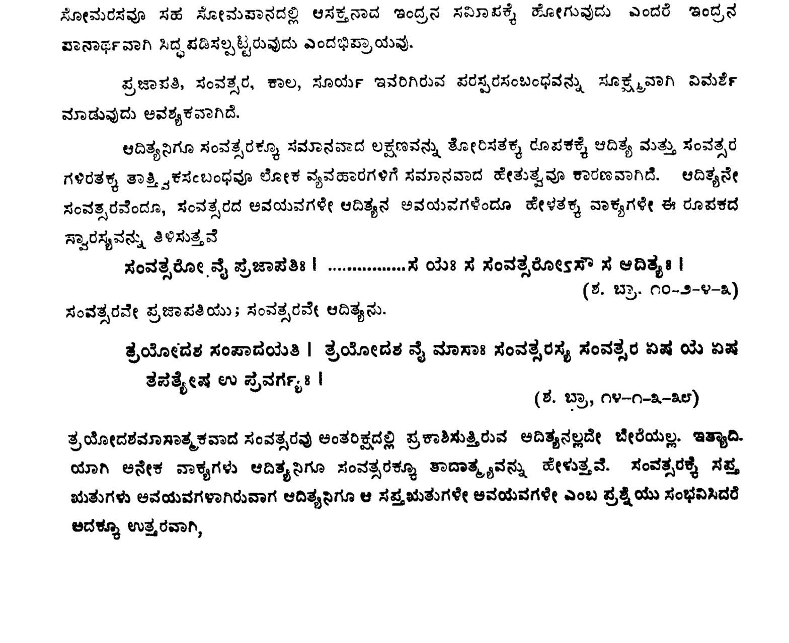
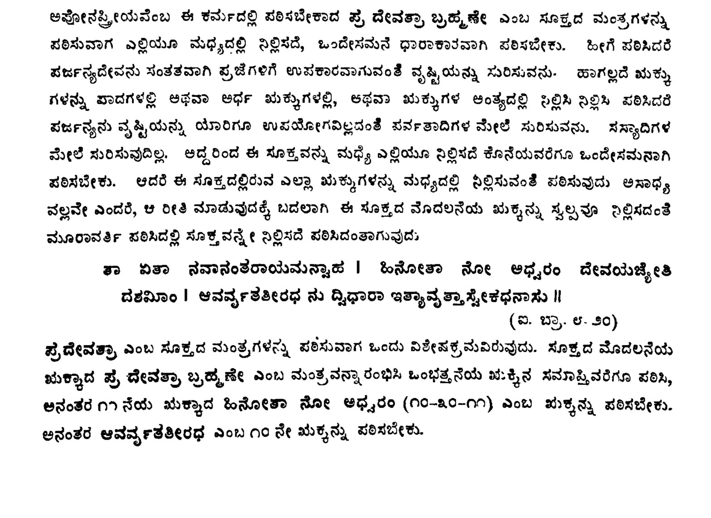
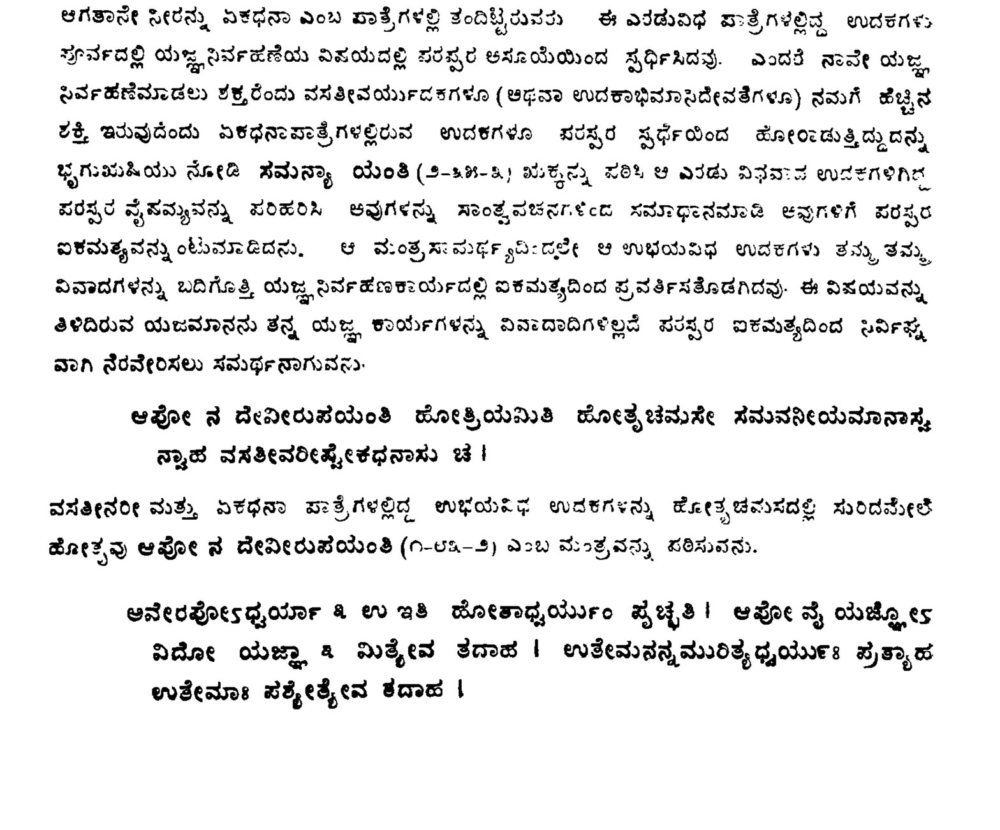
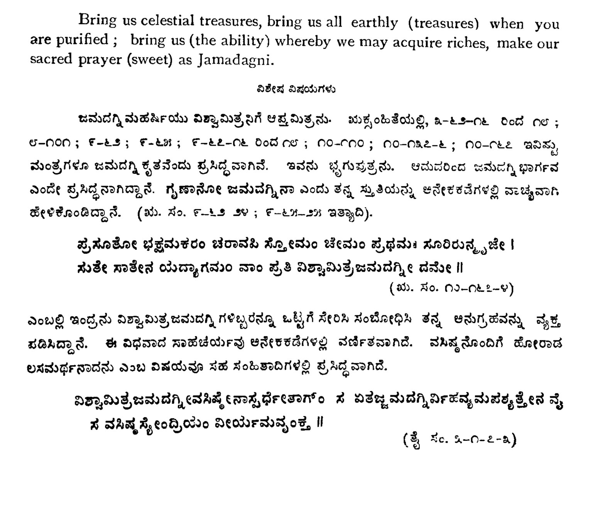
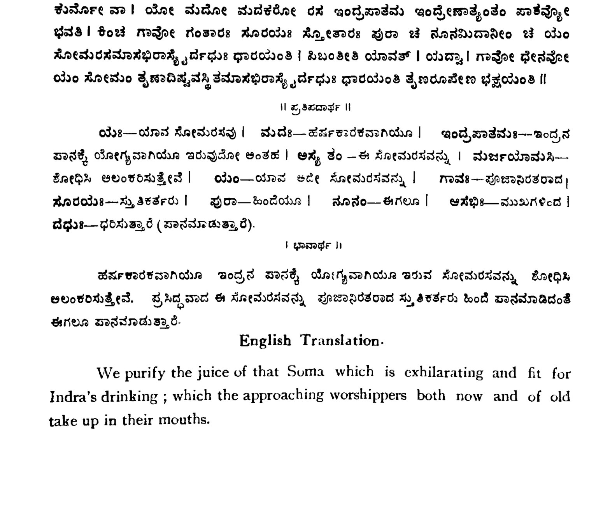

# Vol 26 part 2: references and one word for you to check against the page image

Each block: where it stands, the line as the text reads now, and what the other reader offered (they disagreed about the print's digit shapes, so none of these is certain). The image is the bottom half of the PDF page; the answer goes back as a reading for each mark.

## p1012 (printed 821), line 11

> (ಶ. ಬ್ರಾ. ೧೪-೧-೨[?]-೩೪[?])

- mark 1: text now `೧೪-೧-೨[?]`; other reader: ೧೪-೧-೩ (likely)
- mark 2: text now `೧೪-೧-೨[?]-೩೪[?]`; other reader: ೧೪-೧-೩-೩೮ (likely)

## p1033 (printed 842), line 8

> ತಾ ಏತಾ ನವಾನಂತರಾಯಮನ್ವಾಹ । ಹಿನೋತಾ ನೋ ಅಧ್ವರಂ ದೇವಯಜ್ಯೇತಿ ದಶಮೀಂ । ಆವರ್ವೃತತೀರಧ ನು ದ್ವಿಧಾರಾ ಇತ್ಯಾವೃತ್ತಾಸ್ವೇಕಧನಾಸು ॥ (ಐ. ಬ್ರಾ. ೮. ೨೦[?])

- mark 1: text now `೨೦[?]`; other reader: ೩೦ (likely)

## p1035 (printed 844), line 7

> ವಸತೀವರೀ ಮತ್ತು ಏಕಧನಾ ಪಾತ್ರೆಗಳಲ್ಲಿದ್ದ ಉಭಯವಿಧ ಉದಕಗಳನ್ನು ಹೋತೃಚಮಸದಲ್ಲಿ ಸುರಿದಮೇಲೆ ಹೋತೃವು ಆಪೋ ನ ದೇವೀರುಪಯಂತಿ (೧-೯೩-೨[?]) ಎಂಬ ಮಂತ್ರವನ್ನು ಪಠಿಸುವನು.

- mark 1: text now `೧-೯೩-೨[?]`; other reader: ೧-೮೩-೨ (likely)

## p1045 (printed 854), line 9

> ಜಮದಗ್ನಿ ಮಹರ್ಷಿಯು ವಿಶ್ವಾಮಿತ್ರನಿಗೆ ಆಪ್ತಮಿತ್ರನು. ಋಕ್ಸಂಹಿತೆಯಲ್ಲಿ, ೩-೬೨-೧೭ ರಿಂದ ೧೮ ; ೮-೧೦೧ ; ೯-೬೨ ; ೯-೬೫ ; ೯-೬೨[?]-೧೭[?] ರಿಂದ ೧೮ ; ೧೦-೧೧೦ ; ೧೦-೧೩೨[?]-೬[?] ; ೧೦-೧೬೭ ಇ

- mark 1: text now `೯-೬೨[?]`; other reader: ೯-೬೭ (likely)
- mark 2: text now `೯-೬೨[?]-೧೭[?]`; other reader: ೯-೬೭-೧೬ (likely)
- mark 3: text now `೧೦-೧೩೨[?]`; other reader: ೧೦-೧೩೭ (likely)
- mark 4: text now `೧೦-೧೩೨[?]-೬[?]`; other reader: ೧೦-೧೩೭-೬ (likely)
- mark 5: text now `೯-೬೫-೩೭[?]`; other reader: ೯-೬೫-೨೫ (likely)

## p1045 (printed 854), line 15

> (ತೈ. ಸಂ. ೩-೧-೧೨[?]-೩[?])

- mark 1: text now `೩-೧-೧೨[?]`; other reader: none
- mark 2: text now `೩-೧-೧೨[?]-೩[?]`; other reader: none

## p1071 (printed 880), line 17

> ಯಃ—ಯಾವ ಸೋಮರಸವು | ಮದಃ—ಹರ್ಷಕಾರಕವಾಗಿಯೂ | ಇಂದ್ರಪಾತಮಃ—ಇಂದ್ರನ ಪಾನಕ್ಕೆ ಯೋಗ್ಯವಾಗಿಯೂ ಇರುವುದೋ ಅಂತಹ | ಅಸ್ಯ ತಂ—ಈ ಸೋಮರಸವನ್ನು | ಮರ್ಜಯೋಮುಸಿ[?]—ಶೋಧಿಸಿ ಅಲಂಕರಿಸುತ್ತೇವೆ | ಯಂ—ಯಾವ ಅ

- mark 1: text now `ಮರ್ಜಯೋಮುಸಿ[?]`; other reader: none
